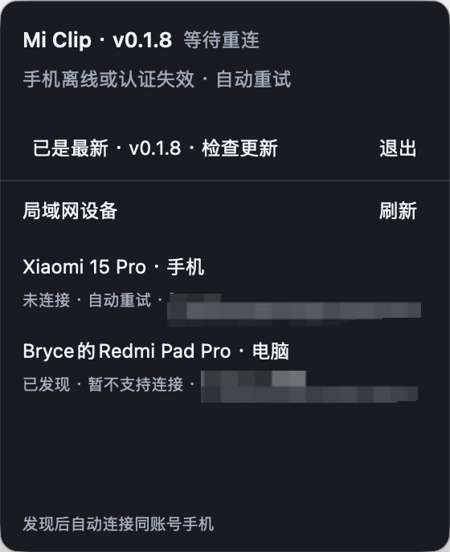

# Mi Clip

轻量的 macOS 小米共享剪贴板客户端，Rust 实现，状态栏 UI 使用 gpui-rhai。
手机使用系统内置互联功能，无需安装新软件。运行时不加载小米官方库。

    
    

## 当前范围

- 双向 UTF-8 短文本，每次最多 3072 字节；不支持富文本或长文本。
- Mac 在 Finder 复制普通文件后，手机兼容应用可按需取用文件；已验证 HEIC 图片在微信粘贴并发送。
- Mac 直接复制的 PNG、JPEG、GIF、TIFF 图片也可在内存中生成文件供手机按需取用；编码数据单张最多 32 MiB，不保存到磁盘。图片优先于附带文字，重连会重新提供当前图片。
- 文件通知只包含文件名和类型，手机请求后才传正文；不把 Finder 附带的文件名作为文本同步。
- 仅保留当前复制的文件引用或图片快照；重新复制即撤销旧引用，源文件修改后须重新复制。
- 不支持复制文件夹、承诺文件，以及手机复制图片或文件后自动写入 Mac 剪贴板；不支持的内容保留 Mac 原有剪贴板。
- 手机与 Mac 在同一局域网，并开启手机互联功能。
- 协议中广播的设备名为 Clip；手机系统分享页可以发现并向 Mac 发送文件。
- 文件默认保存在 ~/Downloads，完整校验后才显示文件；同名文件自动另存，已有文件不会覆盖。
- 单次接收最多 128 个文件、合计 8 GiB；尚未验证多文件、大文件和其他机型。
- Mac 文件剪贴板单次最多 128 个普通文件、合计 8 GiB；手机是否能粘贴取决于系统和目标应用。
- 应用版包含“Clip 分享”系统共享扩展：Finder 右键文件 → 共享 → Clip 分享，直接向已连接手机发起接收并保存请求，无需在手机应用里粘贴。独立二进制不包含系统共享入口。
- 主动分享已通过本地合成收发测试，真实手机弹窗与保存尚待实机验证；不能通过 macOS 隔空投送查找或发送到手机。
- 已认证的文件分享请求会触发橙色图标闪动和系统通知；点开面板查看后消除标记。
- 接收时显示蓝色传输动画，全部文件保存后显示绿色完成对勾并发送通知。
- 动画约每秒 12 帧，结束后停止刷新；遵循系统“减少动态效果”，不新增图形依赖。
- 系统横幅使用 macOS 内置通知命令，受系统通知设置控制；不显示文件名或内容。
- 菜单栏常驻一个自行设计的单色图标，无主窗口和 Dock 图标。
- 状态面板的版本更新下方显示局域网设备列表、连接/认证状态与刷新按钮；列表自动刷新，设备信息仅保存在内存。
- 通过 mDNS（_lyra-mdns._udp）发现手机，经 UDP/KCP 双向认证后声明 Clip 文件分享能力；手机分享页出现 Clip 需要先完成连接。
- 点击打开小型状态面板；再次点击图标、点击外部或按 Esc 可收起；“退出”和 Cmd-Q 结束程序。
- 连接断开后自动重新发现并重试，剪贴板读取使用系统原生接口。
- 连接失败时，面板显示失败阶段、具体错误和重试间隔；重试期间保留上一次错误，连接成功后清除。
- 每次连接失败也会向标准错误输出时间戳、失败阶段和完整错误链；后台启动时可将 stderr 重定向到私有日志文件，默认不创建日志文件。
- 正常运行不保存剪贴板正文、传输报文或临时会话密钥；主动分享的文件在扩展沙盒中短暂暂存。
- 自申请的账号会话和设备证书保存在本机私有目录，文件权限 0600。
- 同账号证书、临时公钥签名、服务端密钥确认及 AES-GCM 消息认证均验证后使用。

## 验证范围

已在 Intel Mac 与一台 HyperOS 3 小米手机上验证：退出官方 Mac 客户端后，
手机复制的测试文本可以写入 Mac 系统剪贴板；反向文本由手机粘贴确认一致。
手机系统分享发送的一个小文件已完整接收，并由手机确认传输成功。
Mac Finder 复制的一个 HEIC 文件已通过独立客户端传至手机，在微信粘贴并发送成功。
Mac 直接复制的 PNG 图片也已在手机微信确认出现预览并发送成功；传输完成由手机协议确认。
其他文件格式、多文件和大文件的手机粘贴行为尚未验证；本地合成测试覆盖分片与完成确认。
其他系统版本和设备组合尚未验证。这是早期协议互操作版本。

## 构建

需要 macOS、Xcode Command Line Tools 和 Rust 1.95 或更高版本。
    ./tools/build-release.sh --bin mi-clip
    ./target/release/mi-clip

构建脚本移除个人源码目录和 Cargo 缓存路径。Rhai 脚本及图标嵌入单一二进制。
默认构建只输出状态栏程序，不需要安装 Node、Python 或官方互联客户端。

## Finder 系统共享

构建包含原生共享扩展的应用：

    sh tools/build-app.sh

将 `target/app/Clip.app` 移到 `/Applications`，退出旧的独立客户端后启动 Clip。
应用沿用 `~/Library/Application Support/MiClip/config.json` 的登录配置。
在 Finder 中选中普通文件，右键 → 共享 → **Clip 分享**，然后在手机上确认接收。
如果菜单尚未显示，可在系统设置的扩展管理 → 共享中启用 Clip 分享（不同 macOS 版本的位置略有不同）。
这是独立的文件分享流程，不修改剪贴板。单次最多 128 个普通文件、合计 8 GiB。
扩展在自己的沙盒中暂存文件，显示等待、发送进度和手机确认结果；完成、取消或失败后清理暂存。
关闭共享窗口会取消未完成的请求；连接失败不会在下次启动时自动重发。
目前向当前已认证的单台手机发送，尚未实现多设备选择。

本地默认使用 ad-hoc 签名；分发构建可设置 `MI_CLIP_CODESIGN_IDENTITY` 使用自己的签名身份，
签名和公证仍需按分发环境配置。本仓库没有 Apple Developer ID 证书。
应用版更新应替换完整 `Clip.app`；原来的单二进制自动更新在应用版中停用，以免破坏包含扩展的签名。
独立二进制的更新方式不变。Release 工作流同时生成对应架构的 `Clip-macos-*.zip`。

## 首次登录

从 Release 下载对应架构的文件后，重命名为 mi-clip，并执行 chmod +x mi-clip。
以下命令都由同一个 mi-clip 二进制提供。授权状态不要放进源码仓库。
    umask 077
    miclip_dir="$HOME/Library/Application Support/MiClip"
    mkdir -p "$miclip_dir"
    chmod 700 "$miclip_dir"
    ./mi-clip --auth prepare "$miclip_dir/qr-state.json" "$miclip_dir/qr.png"
    open "$miclip_dir/qr.png"

用手机扫码并确认登录后执行：
    ./mi-clip --auth poll "$miclip_dir/qr-state.json" "$miclip_dir/grant.json"
    ./mi-clip --auth redeem "$miclip_dir/grant.json" "$miclip_dir/session.json"
    ./mi-clip --auth account-cert "$miclip_dir/session.json" "$miclip_dir/account.pem"
    ./mi-clip --auth device-cert "$miclip_dir/session.json" "$miclip_dir/device"

二维码约 5 分钟过期；poll 遇到等待超时可在二维码有效期内重试。
redeem 的一次性授权不要重复兑换；账号失效时重新执行登录流程。
在上述私有目录创建 config.json，内容如下：
    {
      "session": "session.json",
      "identity": "device/device.json",
      "account_certificate": "account.pem"
    }
    chmod 600 "$miclip_dir/config.json"

之后直接运行 ./mi-clip。程序会自动读取这个配置并发现同一局域网的手机。
也可指定配置：./mi-clip --config /私有目录/config.json
路径相对于配置文件所在目录解析。请保持手机解锁、互联页面开启以完成首次发现。

## 验证命令

    cargo test --no-default-features --features research --lib
    ./target/release/mi-clip --check-ui
    ./target/release/mi-clip --smoke-test
    python3 tests/probe_test.py ./target/release/mi-clip

## 协议研究

研究 CLI 可单独构建，不依赖 GPUI：
    cargo build --release --no-default-features --features research --bin mi-clip-auth
    ./target/release/mi-clip-auth discover /私有目录/endpoints.json

--auth probe-handshake INPUT OUTPUT 是有界诊断模式，会显式保存私有报文和密钥。
它不是默认运行模式。请勿公开研究输出、登录二维码、会话、证书或密钥。
源码仓库仅包含实现、合成测试和原始图标，没有真实账号、设备标识或抓包。

## 设计取舍

UI 按需创建，正常驻留不运行 Rhai 面板或隐藏主窗口。
保留 gpui-rhai 时，UI 框架仍占主要二进制体积；协议核心可以独立构建。
网络传输为单手机场景的有界 KCP 实现，尚未覆盖所有网络拥塞和漫游场景。

## 签名自动更新

- 启动约 10 秒后检查一次，之后每小时检查；状态面板可手动检查。
- 面板标题显示当前版本；点击检查后显示“检查中…”，发现新版后单独显示下载状态。
- 签名清单验证通过且没有更高版本时显示“已是最新 · v版本号 · 检查更新”，仍可点击重新检查；检查失败会明确提示重试。
- 从 GitHub Release 获取当前架构的签名清单，并在后台下载较新版本。
- 清单使用独立 P-256 发布密钥签名，二进制验证签名覆盖的 SHA-256、长度和架构。
- 检查通过后点击“更新至 …”，程序停止同步、原子替换并重新启动。
- 保留旧二进制，直到新程序的状态栏报告启动就绪；启动失败则恢复旧版。
- 不接受降级、不执行下载脚本、不引入 Sparkle 或其他更新框架。
- 更新源须允许匿名下载；没有 Release 或没有当前架构的清单时显示“更新尚未发布”。
- 本地开发构建不配置更新源时，不进行可用更新安装。
- 可运行 ./mi-clip --version 查看版本，或 ./mi-clip --check-update 在终端检查并验证更新（不安装，临时下载在检查结束后删除）。

## 更新发布

推送稳定 tag（例如 v0.2.0）后，GitHub Actions 会：
- 从 tag 提取发布版本，在 CI 临时检出目录同步 Cargo.toml 和 Cargo.lock 后再编译，无需手动改版本或提交回仓库。
- 分别在 Intel 和 Apple Silicon 的 macOS runner 上测试并编译优化后的二进制。
- 校验 Rhai 脚本、合成设备协议和更新签名，生成二进制、签名清单及 SHA-256 文件。
- 等两个架构均成功后上传到 GitHub Release，完成上传后再公开新 Release。
- 发布完成后推送飞书消息，包含版本号、两个架构说明、下载链接和构建记录。
仓库 Actions Secret MI_CLIP_SIGNING_KEY 需保存现有 32 字节 P-256 发布私钥的 Base64。
仓库 Actions Secret FEISHU_WEBHOOK_URL 保存飞书机器人的 Webhook 地址，不写入源码。
工作流只上传 release-assets 中的发布文件，签名私钥与配置在临时目录中使用后删除。
只接受 v主版本.次版本.修订版本；不发布预览版或裸数字 tag。源码中的 Cargo 版本仅用于本地开发。

## 发布缓存预热

默认分支 push 或在默认分支手动运行 Warm macOS release cache，会分别预热 Intel 和 Apple Silicon 的协议/更新测试及 Release 依赖。
预热与发布使用相同的 runner、Rust 工具链、macOS 12.0 部署目标，以及 tools/build-release.sh 的路径重映射参数；每种架构共用一个缓存 key。发布任务只恢复缓存，不再保存无法跨标签复用的副本。
首次启用时，先等默认分支两个架构的预热全部成功，再推送下一个版本 tag。首次预热需要完整编译，会增加默认分支的 CI 用量。
发布时按 tag 替换本项目版本的逻辑保持不变，缓存按依赖信息复用；应用自身仍需编译和链接。依赖或工具链变化时可能需要重建，实际提速需在后续发布中确认。
现有 opt-level=s、fat LTO、单 codegen unit 等发布优化设置保持不变。

构建脚本从 origin 的 GitHub 地址推导更新仓库，也可通过环境变量指定：
    MI_CLIP_UPDATE_REPOSITORY=owner/mi-clip ./tools/build-release.sh --bin mi-clip

私钥不属于客户端和仓库。src/update_key.rs 只包含本项目的公开验证密钥。
发布者应备份对应的 32 字节 P-256 私钥，并在所有后续版本沿用这把发布密钥。
在仓库外创建签名配置，例如：
    {
      "version": "0.1.0",
      "arch": "x86_64",
      "repository": "owner/mi-clip",
      "binary": "/构建目录/mi-clip",
      "private_key": "/私有目录/signing.key"
    }
    ./mi-clip --auth sign-update /私有目录/release.json /发布目录

把生成的 mi-clip-macos-x86_64 和 manifest-macos-x86_64.json 放到 v0.1.0 Release。
ARM 构建使用 arch=aarch64 和对应名称。只有 x86_64 已在本机验证。
每次发布使用递增的 tag，CI 确保签名清单和二进制版本一致。手动发布时，先用 Python 3.11+ 执行
    python3 tools/prepare-release.py 0.2.0
再编译二进制，并在签名配置中使用相同版本。
签名配置、私钥及发布输出应保存在源码目录之外。

## 更新验证

    cargo test --no-default-features --features research --lib
    MICLIP_TEST_APP=/构建目录/mi-clip cargo test --no-default-features --features research --lib updater::tests::real_gui_restart_reports_ready -- --ignored --test-threads=1
第二条在临时目录中验证替换和实际 GUI 重启，不替换当前安装的程序。
    python3 tests/update_signature_test.py /发布目录/manifest-macos-x86_64.json /发布目录/mi-clip-macos-x86_64
该测试仅用公开验证密钥和系统 OpenSSL，独立检查真实发布签名及二进制摘要。

## 本机 v0.1.0 验证结果

- Intel macOS 单文件 16,523,352 字节，源码与锁文件合计约 370 KB。
- 26 项 Rust 测试通过，包括真实 GUI 更新重启和失败回退。
- 状态栏启动、Rhai 状态刷新后的 Esc、底部退出按钮及外部关闭事件均通过验证。
- 外部鼠标监听仅在面板打开期间注册，面板关闭即释放。
- 真实发布签名由系统 OpenSSL 独立验证，篡改后的清单被拒绝。
- 手机与 Mac 双向文本同步在官方客户端退出后通过验证。
- 不依赖官方动态库；尚未执行卸载官方 App 的测试。
